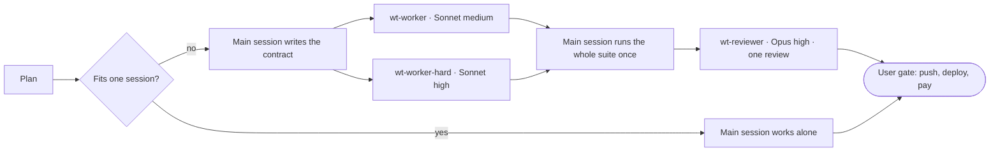
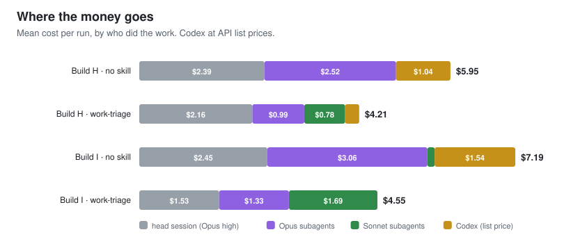
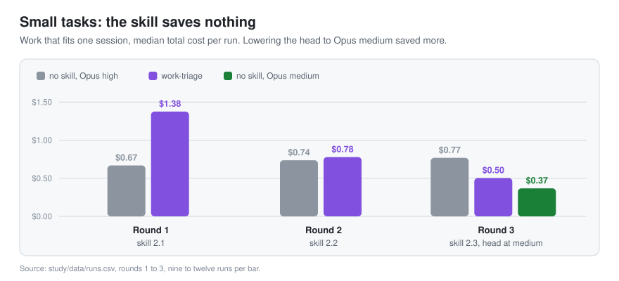

# work-triage

**A skill that makes large agent builds about a third cheaper without making them worse.**
It tells the main session when to work alone and, when it hands work out, which model and level each part gets.

<picture>
  <source media="(prefers-color-scheme: dark)" srcset="study/charts/cost-large-builds-dark.svg">
  
</picture>

| | Build H: 20 plug-in operations | Build I: layered task tracker |
|---|---|---|
| Opus 5.5 `high`, no skill (median of 5 runs) | $6.06 | $7.76 |
| The same with work-triage (median of 5 runs) | **$4.11** | **$4.58** |
| Change | **−32 %** | **−41 %** |
| Exact one-sided rank-sum test | p = 0.0079 | p = 0.0079 |
| Hidden acceptance test (run after the session ends; no session saw it) | 5/5 and 5/5 pass | 5/5 and 5/5 pass |
| Major defects, graded blind (no skill / skill) | 14 / 15 | 27 / 17 |

Both pass bars were written down before the runs. The numbers come from 95 measured runs on nine tasks; the
[study](study/README.md) has the method, the data, every chart's source and the rounds where the skill lost.

## The short version

Splitting work into subagents costs money. A session that hands small work to subagents pays for briefs, waiting
and reading results, and in our first round an earlier version of this skill did exactly that: **twice as
expensive as no skill at all.** What survived six rounds of measurement is small:

1. **Size first.** Work that fits one session is done by that session, alone. No delegation, no plan table.
2. **The main session keeps its model and level** (Opus 5.5 `high` in the study). Lowering it to `medium` halved
   the cost of small tasks but drew major review findings in 2 of 9 runs, among them the study's only security
   findings.
3. **The cheapest fit for each batch.** Each batch of work gets the cheapest model and level that fits it (see the
   table below). A large build goes to four or five workers that each take a batch of modules, not to twenty
   single-module workers, and never to a subagent that silently inherits the main session's model.
4. **Agents that carry their own rules.** Three omp (oh-my-pi) agent definitions ship with the skill; each knows
   its model, its level, how to work economically and what to check before it reports.
5. **Exactly the spec, not stricter.** Half of the serious defects in the first large build were restrictions
   nobody had asked for. Workers and the reviewer now look for them.

| Work | Who gets it |
|---|---|
| Spec'd modules, tests and docs | `wt-worker` (Sonnet 5.5 `medium`) |
| The same with dense edge cases or an approach to choose | `wt-worker-hard` (Sonnet 5.5 `high`) |
| Taste: copy, UI polish, image and video prompts | Opus 5.5 `medium`, named per call |
| Floors: security, secrets, an interface still to decide | Opus 5.5 `high` |
| One review of the merged result | `wt-reviewer` (Opus 5.5 `high`) |
| The shared contract and the integration | the main session |

The study's two large builds were spec'd Python code, so they exercised only the two Sonnet rows, the main session
and the reviewer.



## Where the money goes

<picture>
  <source media="(prefers-color-scheme: dark)" srcset="study/charts/cost-split-dark.svg">
  
</picture>

Without the skill, the same model spawned five to seven Opus subagents per build and usually asked the most
expensive Codex model for a review. With it, the modules go to Sonnet and one Opus reviewer checks the merged
result. The main session is the largest single item either way.

## It did not start out like this

<picture>
  <source media="(prefers-color-scheme: dark)" srcset="study/charts/journey-dark.svg">
  
</picture>

Every bar is a version that was measured against the same model without the skill, on the same tasks, with hidden
tests neither side saw. [The study](study/README.md#rounds) lists every round, including those the skill lost.

## Install

The skill is written for omp (oh-my-pi) first; see [Made for omp](#made-for-omp) for what that means.

**omp** reads skills one level under a skills root:

```bash
git clone https://github.com/LinusKon/work-triage.git ~/src/work-triage
mkdir -p ~/.agents/skills
ln -s ~/src/work-triage/skills/work-triage ~/.agents/skills/work-triage
omp skill list   # work-triage should be listed
```

The three agents (`wt-worker`, `wt-worker-hard`, `wt-reviewer`) are copied by the skill into a project's
`.omp/agents/` the first time it orchestrates a build there. To have them everywhere:

```bash
mkdir -p ~/.omp/agent/agents
cp ~/src/work-triage/skills/work-triage/agents/*.md ~/.omp/agent/agents/
```

**Claude Code**, as a plugin inside a session:

```text
/plugin marketplace add LinusKon/work-triage
/plugin install work-triage@work-triage
```

Then start work as usual, for example: *"Load the work-triage skill, then plan and build this: …"*.
The measurements were taken in omp 18.20.3. In Claude Code the skill's rules apply, but the three agent files are
omp definitions: in Claude Code the same roles are spawned with model and effort named in each call (see
[`references/harness-claude-code.md`](skills/work-triage/references/harness-claude-code.md)).

## Made for omp

The skill started as a fix for one omp habit and grew around how omp hands out work. Each row below is one omp
behaviour, what it cost in practice, and the rule that answers it:

| In omp | What goes wrong | What the skill does |
|---|---|---|
| The task tool's `effort` hint is relative: `hi` is the highest level the chosen model supports, so `max` on Opus 5.5 and Sonnet 5.5 | "High effort" silently becomes the most expensive level. One project ran about forty subagents a level too high; that bill is where this skill began | Never uses `effort`. Workers are omp agents with a fixed `thinking-level`; every other spawn names `provider/model:level` |
| A spawn without a model runs on the main session's model and level | A forgotten selector puts a routine module on Opus `high` | Every spawn names an agent or a model. The three `wt-*` agents carry model, level and rules in their frontmatter |
| An Opus session picks its own subagents | In ten baseline builds, 51 of 52 subagents were Opus; Sonnet was used once | Spec'd modules go to `wt-worker` (Sonnet `medium`) and `wt-worker-hard` (Sonnet `high`); all 37 Sonnet workers of the skill's large builds ran at exactly those levels |
| Codex is one shell command away | Nine of ten baseline builds bought reviews on `gpt-6-astra` `high`, the most expensive model | Codex rows go through `scripts/codex_row.sh`, which refuses to run without an explicit model and level |
| Each spawn starts a fresh session with its own system prompt | Every spawn pays a fixed price of about 12k tokens before it does anything | Few workers with large batches: four to six modules each, the shared contract sent once in the batch's `context` |

What the skill relies on: project agents in `.omp/agents/`, the `agent` and `context` fields of the task tool,
`write agent://<name>` to send a fix back to its author, and the per-call `model` selector for everything the three
agents do not cover. [`references/harness-omp.md`](skills/work-triage/references/harness-omp.md) has the settings
and how to read back the level a subagent really ran at.

## What is in the skill

| File | What it holds |
|---|---|
| [`SKILL.md`](skills/work-triage/SKILL.md) | The core, about 130 lines: size first, orchestrating a build, floors, gates, working economically, the spec check and hardening pass |
| [`agents/`](skills/work-triage/agents) | `wt-worker` (Sonnet 5.5 `medium`), `wt-worker-hard` (Sonnet 5.5 `high`), `wt-reviewer` (Opus 5.5 `high`) |
| [`references/spawn.md`](skills/work-triage/references/spawn.md) | Plan table, model rungs (the order models are escalated through), waves of parallel rows, chains of dependent steps, and escalation for work that needs more than the three agents |
| [`references/calibration.md`](skills/work-triage/references/calibration.md) | What each rule rests on |
| [`scripts/codex_row.sh`](skills/work-triage/scripts/codex_row.sh) | Runs a Codex row with an explicit model and level and without API keys in its environment |

**Floors and gates** hold whatever the size: security and secrets work stays on Opus `high` and gets one review;
key changes, pushes, deploys, paid calls and anything irreversible happen only on the user's word.

## What the study does and does not show

- **Shown, on two builds of different shape:** a median 32 % and 41 % lower total cost (Claude dollars plus Codex at
  API list prices) at the same hidden-test result, with no more major defects on the second build under a rule
  fixed in advance, and equal defects on the first under uniform grading done after the runs.
- **Not a speed-up.** The skill's runs took 21 % and 40 % longer (median 14.5 and 17.6 minutes).
- **Not for small tasks.** On work that fits one session the skill saves nothing; it now only says so.

<picture>
  <source media="(prefers-color-scheme: dark)" srcset="study/charts/small-tasks-dark.svg">
  
</picture>

- **Narrow by design.** One harness (omp 18.20.3), one main-session model (Opus 5.5 `high`), Python builds that take
  a session ten to twenty minutes, five runs per arm (an arm is one setup: skill or no skill), tasks written by the
  skill's authors. In Claude dollars alone the saving is 20 % and 23 %; the rest is Codex work the baseline bought
  at a higher price.
- **Quality is the same, not better.** Both arms ship one to six spec-edge defects per build that neither tests nor
  reviews caught reliably.

<picture>
  <source media="(prefers-color-scheme: dark)" srcset="study/charts/defects-dark.svg">
  
</picture>

## Reproduce it

Everything needed is in [`study/`](study): the nine task specifications, the hidden tests, the runner, the cost
collector with its exact permutation test, the blind-review script, the adjudicated defect lists (one blind grader
merged every review's findings and graded them by one rubric) with one executable probe per defect, and one CSV
row per run.

```bash
python3 study/collect.py --selftest                 # the permutation test and the parsers
python3 study/charts.py study/data study/charts      # redraw every chart from the CSV files
python3 tests/work-triage/score.py --selftest        # the plan-table scorer
```

Running the study itself needs omp, access to the models, and about $5 per large-build run.

## Repository map

```
skills/work-triage/     the skill: SKILL.md, agents/, references/, scripts/
study/                  method, data, charts, tasks, hidden tests, harness, adjudication
tests/work-triage/      scorer and fixtures for the plan-table format
.claude-plugin/         Claude Code plugin manifest
```

## Licence

MIT. See [LICENSE](LICENSE). Changes are listed in [CHANGELOG.md](CHANGELOG.md).
