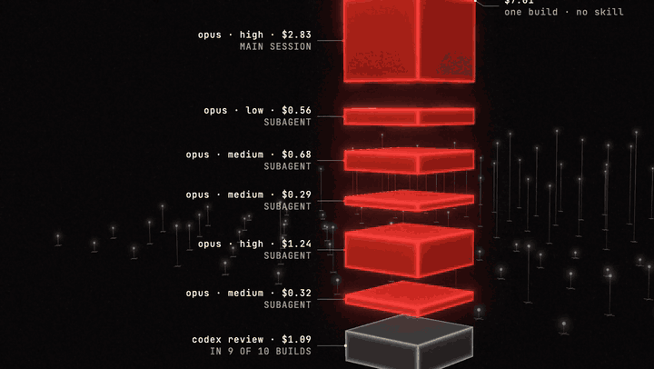
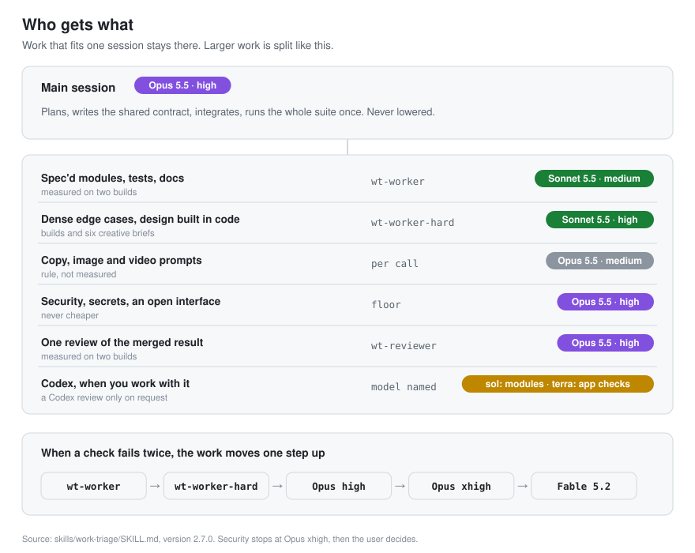
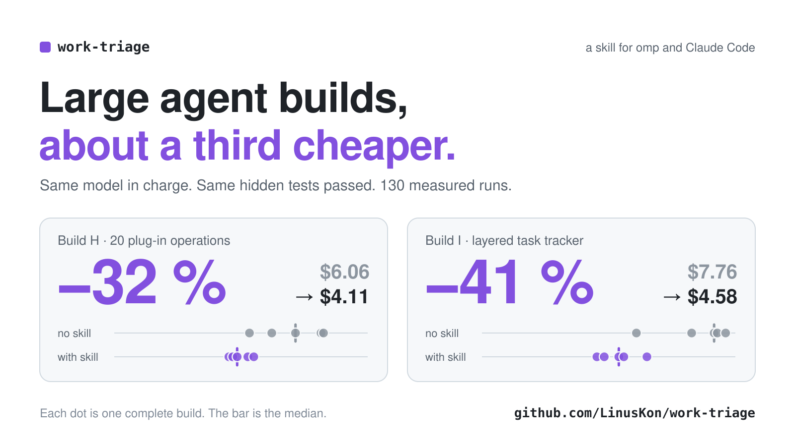
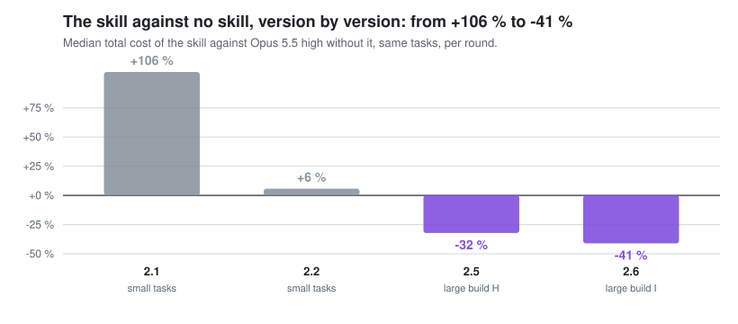
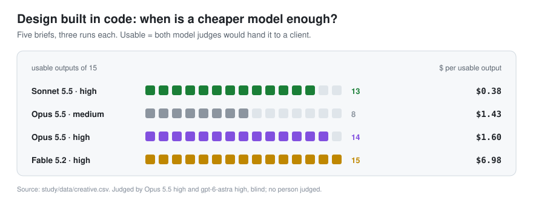

# work-triage

A skill for omp (oh-my-pi) and Claude Code that decides which model and thinking level each piece of agent work gets.

<a href="study/film/work-triage-1920x1080.mp4"></a>

36-second film with sound: [16:9](study/film/work-triage-1920x1080.mp4) · [4:5](study/film/work-triage-1080x1350.mp4)

- **What it saves:** about a third of the cost of a large agent build, with the same hidden acceptance tests
  passing. The saving depends on the harness version, so it is measured per omp version.
- **How:** Opus plans, integrates and reviews; Sonnet builds; Codex gets the jobs it is good at, with the model
  always named. Risky work (security, secrets, open interfaces) stays on Opus `high` and is never handed down; a
  module that keeps failing moves up.
- **When it does nothing:** work that fits one session. That session does it alone, and the skill only says so.

## Install

The skill is written for omp first; see [Made for omp](#made-for-omp) for what that means.

**omp** reads skills one level under a skills root:

```bash
git clone https://github.com/LinusKon/work-triage.git ~/src/work-triage
mkdir -p ~/.agents/skills
ln -s ~/src/work-triage/skills/work-triage ~/.agents/skills/work-triage
omp skill list   # work-triage should be listed
```

The three agents (`wt-worker`, `wt-worker-hard`, `wt-reviewer`) are copied by the skill into a project's
`.omp/agents/` the first time it orchestrates a build there. To have them everywhere:

```bash
mkdir -p ~/.omp/agent/agents
cp ~/src/work-triage/skills/work-triage/agents/*.md ~/.omp/agent/agents/
```

**Claude Code**, as a plugin inside a session:

```text
/plugin marketplace add LinusKon/work-triage
/plugin install work-triage@work-triage
```

Then start work as usual, for example: *"Load the work-triage skill, then plan and build this: …"*.
In Claude Code the skill's rules apply, but the three agent files are omp definitions: the same roles are spawned
with model and effort named in each call (see
[`references/harness-claude-code.md`](skills/work-triage/references/harness-claude-code.md)).

## Who gets what

<picture>
  <source media="(prefers-color-scheme: dark)" srcset="study/charts/routing-dark.svg">
  
</picture>

| Work | Who gets it |
|---|---|
| The shared contract and the integration | the main session, which keeps its model and level (Opus 5.5 `high` in the study) |
| Spec'd modules, tests and docs | `wt-worker` (Sonnet 5.5 `medium`), four to six modules per worker |
| The same with dense edge cases or an approach to choose | `wt-worker-hard` (Sonnet 5.5 `high`) |
| Design built in code: pages, motion, 3D scenes | Sonnet 5.5 `high`; Opus 5.5 `high` for a better result at three to five times the price; never Opus `medium`; Fable 5.2 only when the best possible result is asked for |
| Copy, image and video prompts | Opus 5.5 `medium`, named per call |
| Floors: security, secrets, an interface still to decide | Opus 5.5 `high`, never cheaper |
| One review of the merged result | `wt-reviewer` (Opus 5.5 `high`) |
| Codex, optional | `gpt-6.1-sol` for spec'd modules, `gpt-6.1-terra` `medium` for local app checks, model and level always named; a Codex review only on request |

A module that fails twice moves one step up: `wt-worker` → `wt-worker-hard` → Opus `high` → `xhigh` → Fable 5.2.
Pushes, deploys, paid calls, key changes and anything irreversible happen only on the user's word.

The two large builds measured the two Sonnet rows, the main session and the reviewer; the design row rests on 90
runs on six creative briefs. The copy row, the floors and the Codex rows are rules, not measurements.

## The evidence

| Large build, five runs per setup, median total cost | No skill | With the skill | Change | p |
|---|---|---|---|---|
| H: 20 plug-in operations, omp 18.21.0 | $6.06 | $4.11 | −32 % | 0.0079 |
| I: layered task tracker, omp 18.21.0 | $7.76 | $4.58 | −41 % | 0.0079 |
| I, omp 18.22.0 | $5.91 | $4.25 | −28 % | 0.0159 |
| I, omp 18.22.0, prompt names no Codex: Claude only | $6.43 | $4.28 | −33.5 % | 0.0040 |

Every run passed a hidden acceptance test that ran after the session ended and no session saw. p is an exact
one-sided rank-sum test; the pass bars for the first two rows were written down before the runs. omp 18.22.0 runs
subagents at lower thinking levels by itself, so its baseline is cheaper; a saving measured in one version does not
carry to the next.

<picture>
  <source media="(prefers-color-scheme: dark)" srcset="study/charts/share-card-dark.svg">
  
</picture>

- **Small tasks: no saving.** On work that fits one session the skill saves nothing, so it now only says so.
- **Quality: the same, not better.** Major defects, graded blind: 14 without the skill and 15 with it on build H,
  27 and 17 on build I. Both arms ship one to six spec-edge defects per build that tests and reviews missed.
- **Speed: slower.** The skill's runs took 21 % and 40 % longer (median 14.5 and 17.6 minutes).

It did not start out like this: the first version cost twice as much as no skill, and the
[study's rounds](study/README.md#rounds) list every version, including those the skill lost.

<picture>
  <source media="(prefers-color-scheme: dark)" srcset="study/charts/journey-dark.svg">
  
</picture>

**Design built in code.** A separate test gave five design briefs (a title sequence, a landing page, a 3D scene, a
logo sting, a pricing page) to four models, three runs each. Sonnet 5.5 `high` gave a usable result in 13 of 15
runs, Opus 5.5 `high` in 14 at three to five times Sonnet's price, Fable 5.2 `high` in 15 at four to twelve times
Opus `high`, and Opus `medium` in only 8, at a higher price than Sonnet. Two models judged the outputs blind (Opus
5.5 `high` and `gpt-6-astra` `high`), not a person, and they agreed with each other only moderately.

<picture>
  <source media="(prefers-color-scheme: dark)" srcset="study/charts/creative-dark.svg">
  
</picture>

The [study](study/README.md) has the method, the data, every chart's source and its limits: one harness, one
main-session model, Python builds written by the skill's authors, five runs per arm.

## Made for omp

The skill started as a fix for one omp habit and grew around how omp hands out work. Each row below is one omp
behaviour, what it cost in practice, and the rule that answers it:

| In omp | What goes wrong | What the skill does |
|---|---|---|
| The task tool's `effort` hint is relative: `hi` is the highest level the chosen model supports, so `max` on Opus 5.5 and Sonnet 5.5 | "High effort" silently becomes the most expensive level. One project ran about forty subagents a level too high; that bill is where this skill began | Never uses `effort`. Workers are omp agents with a fixed `thinking-level`; every other spawn names `provider/model:level` |
| A spawn without a model runs on the main session's model and level | A forgotten selector puts a routine module on Opus `high` | Every spawn names an agent or a model. The three `wt-*` agents carry model, level and rules in their frontmatter |
| An Opus session picks its own subagents | In ten baseline builds, 51 of 52 subagents were Opus; Sonnet was used once | Spec'd modules go to `wt-worker` (Sonnet `medium`) and `wt-worker-hard` (Sonnet `high`); all 37 Sonnet workers of the skill's large builds ran at exactly those levels |
| Codex is one shell command away | Nine of ten baseline builds bought reviews on `gpt-6-astra` `high`, the most expensive model | Codex rows go through `scripts/codex_row.sh`, which refuses to run without an explicit model and level |
| Each spawn starts a fresh session with its own system prompt | Every spawn pays a fixed price of about 12k tokens before it does anything | Few workers with large batches: four to six modules each, the shared contract sent once in the batch's `context` |

What the skill relies on: project agents in `.omp/agents/`, the `agent` and `context` fields of the task tool,
`write agent://<name>` to send a fix back to its author, and the per-call `model` selector for everything the three
agents do not cover. [`references/harness-omp.md`](skills/work-triage/references/harness-omp.md) has the settings
and how to read back the level a subagent really ran at.

## What is in the skill

| File | What it holds |
|---|---|
| [`SKILL.md`](skills/work-triage/SKILL.md) | The core, about 140 lines: size first, orchestrating a build, floors, gates, working economically, the spec check ("exactly the spec, not stricter") and hardening pass |
| [`agents/`](skills/work-triage/agents) | `wt-worker` (Sonnet 5.5 `medium`), `wt-worker-hard` (Sonnet 5.5 `high`), `wt-reviewer` (Opus 5.5 `high`) |
| [`references/spawn.md`](skills/work-triage/references/spawn.md) | Plan table, model rungs (the order models are escalated through), Codex rows, waves of parallel rows, chains of dependent steps |
| [`references/calibration.md`](skills/work-triage/references/calibration.md) | What each rule rests on |
| [`scripts/codex_row.sh`](skills/work-triage/scripts/codex_row.sh) | Runs a Codex row with an explicit model and level and without API keys in its environment |

## Reproduce it

Everything needed is in [`study/`](study): the task specifications, the hidden tests, the runner, the cost collector
with its exact permutation test, the blind-review script, the adjudicated defect lists with one executable probe per
defect, the creative briefs and judging, and one CSV row per run.

```bash
python3 study/collect.py --selftest                 # the permutation test and the parsers
python3 study/charts.py study/data study/charts      # redraw every chart from the CSV files
python3 tests/work-triage/score.py --selftest        # the plan-table scorer
```

Running the study itself needs omp, access to the models, and about $5 per large-build run.

## Repository map

```
skills/work-triage/     the skill: SKILL.md, agents/, references/, scripts/
study/                  method, data, charts, film, tasks, hidden tests, harness, adjudication
tests/work-triage/      scorer and fixtures for the plan-table format
.claude-plugin/         Claude Code plugin manifest
```

## Licence

MIT. See [LICENSE](LICENSE). Adapted third-party parts are listed in
[THIRD_PARTY_NOTICES.md](THIRD_PARTY_NOTICES.md); changes in [CHANGELOG.md](CHANGELOG.md).
