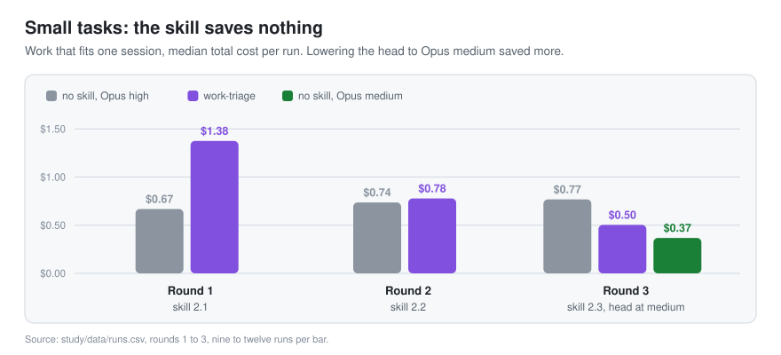
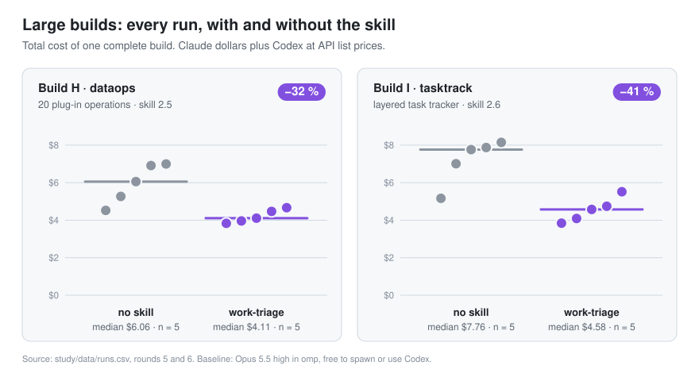
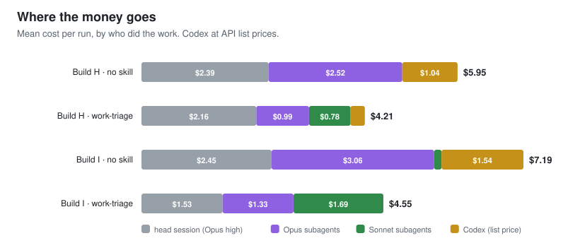
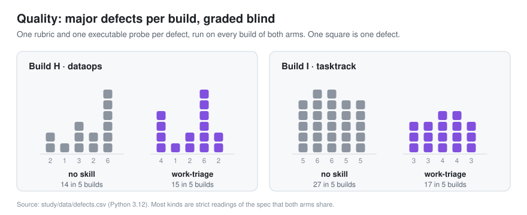

# The study behind work-triage

Does a triage skill make agent work cheaper without making it worse? Six rounds, 95 measured runs, nine tasks, and a
seventh round of 35 runs that measured one large build again on a newer omp (`data/runs.csv` holds 133 rows: three
more are control runs of the final wording).
The short answer: **not on small tasks, yes on large builds**, and the skill had to be rebuilt five times to get
there. This page has the method, the data and every round, including the rounds the skill lost. The calibration
benchmark in [`skills/work-triage/references/calibration.md`](../skills/work-triage/references/calibration.md) is
a separate, earlier body of evidence and is not part of this study.

## Where it started

The skill began with a bill. In one omp project about forty subagents ran a level too high: the task tool's
`effort` hint is relative, so `hi` means the highest level the chosen model supports, which is `max` on Opus 5.5
and Sonnet 5.5, not `high`. Two more habits showed up once we measured: Codex calls ended up on the most expensive
model, and an Opus session left to itself handed work to more Opus sessions, almost never
to Sonnet. The first version of the skill fixed the level and then over-corrected into planning and delegating
everything, which the first round below punished.

## Method

Every run follows the same protocol (`run_study.sh`):

1. **One task, one fresh repository.** The task text is a fixed specification from [`tasks/`](tasks).
2. **Arms differ by one line.** An arm is one setup under test: the skill or no skill (the baseline). Every arm is
   the same model in the same harness (Opus 5.5 in omp, no context files, no installed skills; round 1 ran in omp
   18.20.3, rounds 3 to 6 in 18.21.0, round 7 in 18.22.0, and every run's version is in `data/runs.csv`) with the
   same tools: subagents and the Codex CLI (OpenAI's coding agent). The skill arm's prompt starts with "Read the
   work-triage skill at … and follow it"; the baseline's does not. The saved prompts were compared.
3. **A hidden acceptance test** ([`hidden-tests/`](hidden-tests)) runs after the session ends. No session saw it.
   Each test was first checked against a reference solution written from the specification alone by a different
   model family, and against planted mutants it has to catch.
4. **Cost is read from the session files,** for the main session and every subagent, by `collect.py`. Codex work is
   priced at OpenAI's API list prices so that it can be added to Claude dollars; on a subscription it costs
   allowance instead.
5. **Blind reviews.** A fresh reviewer gets a copy of the result without history, plan or logs, and the
   specification, and does not know the arm (`blind_review.sh`).
6. **Blind, uniform grading of defects** (rounds 5 and 6). Reviewer labels turned out to be uneven: the same defect
   was "major" in one review and "minor" in the next. A blind adjudicator, a fresh reviewer who settles the final
   list, therefore lists every distinct defect from all reviews, grades each by one rubric and writes one
   executable probe per defect ([`adjudication/`](adjudication)); the probes run on every build of both arms.
7. **Bars fixed before the runs,** and every analysis cross-checked by a model of another family, which recomputed
   the numbers from the raw files.

The rubric: a defect is *major* when the behaviour contradicts an explicit sentence of the specification for an
input the specification covers, when the command line ends in a traceback or the wrong exit code, or when a
deliverable is missing; everything else is *minor*.

## Rounds

| Round | Tasks | Skill | Against | Result (median total cost per run) |
|---|---|---|---|---|
| 1 | A–D, small to mid, 3 runs each | 2.1 | Opus `high`, no skill | $1.38 against $0.67: the skill costs twice as much |
| 2 | A–D again | 2.2 | the same | $0.78 against $0.74: equal |
| 3 | E–G, new, small | 2.3 with a `medium` main session | no skill at `high` and at `medium` | $0.50 against $0.77 and **$0.37**: lowering the main session's level alone beat the skill |
| 4 | H, large, 1 run each (pilot) | 2.4 | no skill, free and told to spawn | $4.05 against $6.99 and $6.91 |
| 5 | H, 5 runs each | 2.5 | Opus `high`, no skill | **$4.11 against $6.06, −32 %, p = 0.0079** |
| 6 | I, new, large, 5 runs each | 2.6 | Opus `high`, no skill | **$4.58 against $7.76, −41 %, p = 0.0079** |

Every run of every round passed its hidden test, with and without the skill.

What each round changed in the skill:

- **After round 1:** stop splitting by default. A six-step plan done by one session cost $0.50; the same plan as
  Codex and subagent rows cost $2.38, 83 % of it in the main session's briefs, waits and reads.
- **After round 2:** the skill text shrank from 22 kB to 7 kB (reading it cost about 15k tokens on every turn),
  and two separate floor reviews became one.
- **After round 3:** the main session stays at `high`. A `medium` main session saved more than the skill on small
  tasks but drew major review findings in 2 of 9 runs (3 findings, two of them security, both in one run; reviewer
  labels were uneven). Delegating a small task to one cheap worker cost more than the main session's overhead
  around it. The skill now does nothing on small work except say so.
- **After round 4:** omp agent definitions that carry model, level and rules, so that briefs stay short and no
  worker inherits the main session's model.
- **After round 5:** "exactly the spec, not stricter". The blind grading showed that half of the major defects in
  both arms were restrictions nobody had asked for.

<picture>
  <source media="(prefers-color-scheme: dark)" srcset="charts/small-tasks-dark.svg">
  
</picture>

## The two large builds

**Build H, `dataops`** ([spec](tasks/H.md)): a registry, a pipeline runner, a command line and twenty record
operations, each with tests and a doc page. **Build I, `tasktrack`** ([spec](tasks/I.md)): a task model, a store
with atomic writes, a query language with a parser, date recurrence, three file formats, a report and a command
line. I was written after skill 2.6 was frozen and was never used to tune it.

<picture>
  <source media="(prefers-color-scheme: dark)" srcset="charts/cost-large-builds-dark.svg">
  
</picture>

| | H, no skill | H, skill 2.5 | I, no skill | I, skill 2.6 |
|---|---|---|---|---|
| Runs | 5 | 5 | 5 | 5 |
| Total $ per run, sorted | 4.52 · 5.27 · 6.06 · 6.91 · 7.00 | 3.83 · 3.96 · 4.11 · 4.47 · 4.67 | 5.16 · 7.01 · 7.76 · 7.87 · 8.15 | 3.84 · 4.09 · 4.58 · 4.74 · 5.52 |
| Median total $ | 6.06 | 4.11 | 7.76 | 4.58 |
| Median Claude $ only | 4.76 | 3.83 | 5.92 | 4.58 |
| Median main-session $ | 2.34 | 2.22 | 2.61 | 1.58 |
| Median wall time | 12.0 min | 14.5 min | 12.6 min | 17.6 min |
| Hidden test | 5/5 | 5/5 | 5/5 | 5/5 |

**The bar, fixed in advance for both builds:** median total at least 25 % lower, and an exact one-sided rank-sum
permutation test on the ten totals with p < 0.05. Both builds: rank sum 16, 2 of 252 permutations (every way to
split ten totals into two groups of five), p = 0.0079.

**What the arms did.** Without the skill every run spawned on its own: four to seven Opus subagents at mixed
levels, and in nine of ten runs one to three reviews on the most expensive Codex model. With the skill, eight of ten
runs used the shipped agents (four or five Sonnet workers and one Opus reviewer); two runs of build H sent the
modules to the cheap Codex model in batches instead, at the same cost.

<picture>
  <source media="(prefers-color-scheme: dark)" srcset="charts/cost-split-dark.svg">
  
</picture>

## Quality

<picture>
  <source media="(prefers-color-scheme: dark)" srcset="charts/defects-dark.svg">
  
</picture>

| Defects present, summed over 5 runs (Python 3.12) | H, no skill | H, skill 2.5 | I, no skill | I, skill 2.6 |
|---|---|---|---|---|
| Major | 14 | 15 | 27 | 17 |
| Major on the machine's Python 3.9.6 | 13 | 15 | 23 | 17 |
| Minor | 20 | 20 | 30 | 32 |

- For build I the quality rule was fixed before the runs (sum of majors not above the baseline's) and met. For
  build H the uniform grading was done after the fact, when a cross-check showed that the declared rule had leaned
  on uneven reviewer labels; under it the arms are equal.
- Most "major" kinds rest on a strict reading of the specification that both arms share (a loader that accepts
  slightly more than specified, for example). The adjudicator marked those; [`data/defect-kinds.csv`](data/defect-kinds.csv)
  lists every kind with the number of runs per arm that have it.
- Tracebacks are the clearest kind: on Python ≥ 3.9.14 five baseline builds and no skill build end in a traceback
  on a number with more than 4,300 digits; one baseline build of H crashes on a list-valued join.
- Neither arm is clean. One to six spec-edge defects per build got past the build's own tests and its review.

## Round 7: the same build on a newer omp

A day after round 6, omp had updated itself from 18.21.0 to 18.22.0. The new version gives subagents lower
thinking levels on its own, so the no-skill baseline changed. Build I was run again, five runs per setup, on
2026-11-17. No bar was fixed in advance; the setup is round 6's, and quality was checked by the hidden test only.

| Setup (Opus 5.5 main session, omp 18.22.0) | Median total | Range | Median minutes | Hidden test |
|---|---|---|---|---|
| No skill, prompt names Codex | $5.91 | $4.42 to $6.73 | 12.4 | 5/5 |
| Skill 2.6.1, prompt names Codex | $4.25 | $4.11 to $4.95 | 14.5 | 5/5 |
| No skill, prompt names no Codex | $6.43 | $6.04 to $7.54 | 12.5 | 5/5 |
| Skill 2.6.1, prompt names no Codex | $4.28 | $3.76 to $4.50 | 14.3 | 5/5 |
| No skill, main session at thinking level `auto` | $6.39 | $5.10 to $8.04 | 13.6 | 5/5 |
| No skill text, the skill's three agents installed for the user | $7.59 | $5.07 to $8.71 | 46.9 | 5/5 |
| The same with the main session at `auto` (unplanned, see below) | $4.54 | $3.27 to $5.89 | 11.7 | 5/5 |

- **With Codex named:** the skill costs a median 28.0 % less (exact one-sided rank-sum p = 0.0159). The baseline
  bought a Codex review in four of five runs ($1.26 at list prices in the median); the skill bought none. In Claude
  dollars alone the medians are $4.64 and $4.25.
- **With no Codex named:** the skill costs a median 33.5 % less (p = 0.0040; every skill run was cheaper than every
  baseline run). Without Codex the baseline reviews with Opus subagents at `high` and still runs nearly all workers
  on Opus; the skill's workers run on Sonnet with one Opus review. This is the comparison for someone who uses
  Claude only, and it shows that subtracting Codex dollars from the first comparison understates the saving.
- **The baseline itself got cheaper:** $7.76 in omp 18.21.0, $5.91 in 18.22.0, same prompt. A saving measured in
  one version does not carry to the next; each version needs its own row.
- **Thinking level `auto` saved nothing here:** $6.39 against $5.91 at `high`, ranges overlapping.
- **The agents without the skill's text do not do the job.** With the three agents installed for the user and the
  main session at `high`, the baseline used them but cost more and took almost four times as long. The cheap result
  in the last row happened only together with `auto`; those five runs were meant as a plain `auto` baseline and
  picked up the agents because they had been installed that morning. They are reported, not used for a claim.

## Design built in code: which model, judged blind by two models

The builds above are spec'd code with tests. This part asks a different question: for creative work that ends in
code, does a stronger model give a visibly better result, and from where is the strongest one needed? No skill is
involved; each setup gets the same brief in a fresh folder.

- **Briefs** ([`creative/tasks/`](creative/tasks)): a ten-second title sequence, a landing page, a three.js scene
  and launch copy (first round); a six-second logo sting and a pricing page (second round, with bars fixed in
  advance). Each has hard requirements a script checks (it renders, no console errors, no network, the copy is
  there, the animation is a pure function of time).
- **Setups,** three runs per brief: Sonnet 5.5 `high`, Opus 5.5 `medium`, Opus 5.5 `high`, Fable 5.2 `high`, each
  alone, and a fifth setup in which a strong model writes the direction and critiques once while a Sonnet `high`
  worker builds (Opus directing in the first round, Fable in the second). 90 runs.
- **Judging:** per brief and repetition the five outputs are shown under shuffled labels, without model names, to
  two model judges (Opus 5.5 `high` and `gpt-6-astra` `high`), which see rendered frames and the brief. Each ranks
  the five and, separately, answers for each output "would you hand it to a client": yes, after small fixes, or
  no. **No person judged these outputs.** An output counts as usable when both judges say yes or fix.

| Setup | Usable on the five design briefs (of 15) | Median cost per run, by brief | Mean rank, Opus judge | Mean rank, astra judge |
|---|---|---|---|---|
| Sonnet 5.5 `high` | 13 | $0.12 to $0.62 | 3.67 | 3.78 |
| Opus 5.5 `medium` | 8 | $0.37 to $1.72 | 4.44 | 4.17 |
| Opus 5.5 `high` | 14 | $0.61 to $2.72 | 2.83 | 2.33 |
| Fable 5.2 `high` | 15 | $2.53 to $12.79 | 1.33 | 1.94 |

Ranks are over all 18 screens (1 = best of five). Every output is in [`data/creative.csv`](data/creative.csv).

- **Fable is ranked best and is rarely needed for a usable result.** It costs four to twelve times Opus `high`.
- **Sonnet `high` is usable nearly as often as Opus `high`** at a fifth to a third of the price; both judges rank
  Opus `high` about a place better.
- **Opus `medium` is the worst choice here:** ranked last by both judges and usable in 8 of 15, at a higher price
  than Sonnet `high`. The skill used to send "taste" to Opus `medium`; for design built in code that rule is gone.
- **A strong director with a cheap builder earned no rule.** With Opus directing, it saved 10 % against Opus
  alone and failed on the 3D scene. With Fable directing, it cost 62 % of Fable alone (the bar was 60 %) and the
  two judges disagreed on its rank by a full place.
- **The second round's bars:** "Sonnet `high` first" held (6 of 6 usable) and "never Opus `medium`" held. "Opus
  `high` is needed to be right the first time" did not: Sonnet was usable as often.
- **How far this carries:** the judges agree with each other only moderately (Kendall tau-b 0.65 in the first
  round, 0.37 in the second), one judge is of the same model family as the setups, three runs per cell are few,
  and the copy brief could not be read (one judge rejected most copy from every setup for claims beyond the fact
  sheet). Treat the table as two models' opinion with the method shown, not as taste settled.

A side test ([`planner_bias.py`](planner_bias.py)): asked to give every step of four plans "the cheapest model
that will do it well", neither Opus nor `gpt-6-astra` reached higher for its own family; both went below the
floor on security and interface steps (Opus 9 times, astra 17). Floors are there for that.

## Limits

- Two large builds, both Python, both specified in detail by the skill's authors, each small enough that one
  session could still finish it alone in ten to twenty minutes. They were orchestrated because each is above the
  skill's size threshold (more than about ten files), and the comparison is with a baseline that also chose to
  spawn subagents.
- One harness and one main-session model. Other harnesses spawn differently; the shipped agents are omp definitions.
- Five runs per arm. The cost difference is clear at that size; defect counts are not precise at that size.
- Codex at list prices. In Claude dollars alone the medians differ by 20 % and 23 %.
- The skill is slower.
- Build H's main result belongs to skill 2.5. Three runs of 2.6 on H cost $3.88, $4.01 and $4.24 and passed the
  hidden test; their defects were not graded.
- The skill measured on builds is 2.6.1, which changed wording only against 2.6.0 (the three agent files are
  identical). Three control runs of 2.6.1 on build I cost $3.64, $3.99 and $4.38 and passed the hidden test; their
  defects were not graded. 2.7.0 changes one routing line, for design built in code, which no build exercised.
- The study cost about $630 in Claude usage ($253 for rounds 1 to 6 and the controls, $175 for round 7, about $200
  for the creative part), which is why the cells are small.

## Files

| Path | Content |
|---|---|
| [`data/runs.csv`](data/runs.csv) | One row per run: round, task, arm, skill version, main-session level, omp version, total, Claude and Codex dollars, main-session dollars, tokens, wall time, spawns, hidden-test result, Sonnet and Opus dollars, note |
| [`data/creative.csv`](data/creative.csv) | One row per creative output: brief, setup, cost, minutes, objective checks, both judges' rank and "would you hand it to a client" |
| [`creative/`](creative) | The six briefs, the renderer and checks, the blind ranking page, the judge prompts and the analysis of the creative part; `run_creative.sh` runs one output |
| [`data/defects.csv`](data/defects.csv), [`data/defect-kinds.csv`](data/defect-kinds.csv) | Defects per run and per kind for the two large builds |
| [`charts/`](charts) | Every chart, drawn by `charts.py` from the CSV files, in a light and a dark variant |
| [`tasks/`](tasks) | The nine specifications; `F.seed/` is the seeded repository of task F |
| [`hidden-tests/`](hidden-tests) | The acceptance tests no session saw |
| [`adjudication/`](adjudication) | Per large build: the graded defect list, the probes and their verdicts under two interpreters |
| `run_study.sh`, `collect.py`, `blind_review.sh` | The runner, the cost collector with the permutation test, the blind review |
| `export_data.py`, `export_defects.py`, `charts.py` | From local run folders to the CSV files and charts |

The scripts are published as they ran, with one change: the line that keeps API keys out of child sessions now
strips every variable ending in `_KEY`, `_TOKEN` or `_SECRET` instead of naming one. `run_study.sh` expects the
skill versions and hidden tests under `$STUDY` (default `~/work-triage-study`); the session transcripts themselves
are not published.
